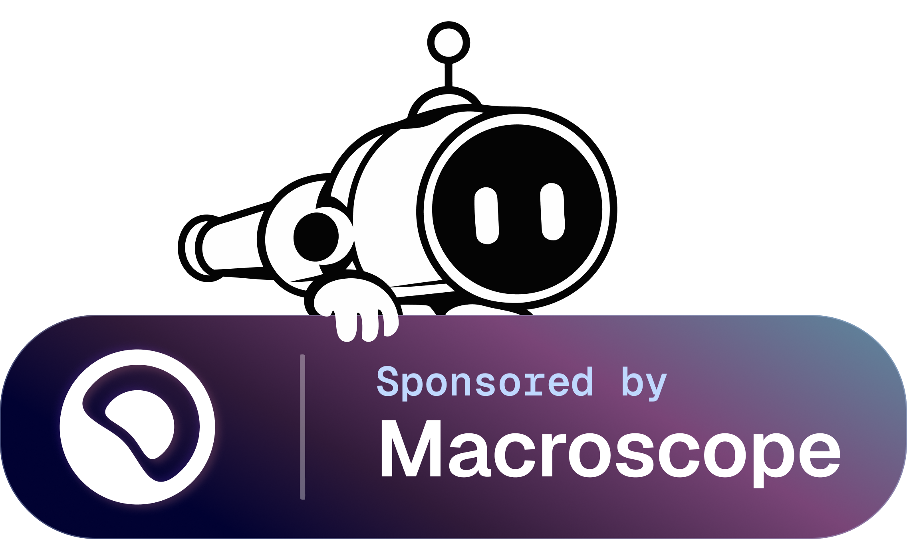

# GenHub — Live Symlink Mode Fork

[](LICENSE)
[](https://github.com/community-outpost/GenHub)
[](https://github.com/dogefly233/GenHub_Symlink-Mode)

> 本分叉基于 [Community Outpost GenHub](https://github.com/community-outpost/GenHub) 的 `development` 分支，重点增加 Live 模式与简体中文本地化，不是上游官方版本。  
> This fork is based on the `development` branch of [Community Outpost GenHub](https://github.com/community-outpost/GenHub). It focuses on Live mode and Simplified Chinese localization and is not an official upstream release.

## 这个分叉做了什么 / What This Fork Adds

### 中文

- **实时符号链接模式（Live Symlink Mode）**：直接把未打包的 Mod 文件夹链接进工作区，跳过 CAS 哈希与复制；源目录的新增、修改、删除会实时反映到工作区。
- **按包启停 Live**：每个内容包单独开关，可与基础游戏、普通 CAS Mod 混合使用。
- **增量工作区**：只启停一个 Live 包时，只增删该包的链接/副本；只有在会破坏 Snapshot 路径时才回退全量重建。
- **写入保护**：`.ini`、`.cfg` 等配置默认复制到工作区，游戏写入不污染源文件；链接型资产仍有写穿风险，详见开发日志。
- **分享/导出拦截**：包含 Live 内容的配置无法导出或分享，避免把本地绝对路径发给他人。
- **简体中文本地化**：新增 `Strings.zh-Hans.resx`，覆盖 Live 模式新增的导入界面、`LIVE` 徽章、分享错误和运行期链接错误；未覆盖的键回退英文。

### English

- **Live Symlink Mode**: link an unpacked mod folder directly into the workspace, skipping CAS hashing and copying. Additions, edits and deletions in the source are reflected live.
- **Per-package Live toggle**: enable Live mode for individual packages and mix them with the base game and regular CAS content.
- **Incremental workspace**: enabling or disabling one Live package only adds or removes that package's links/copies; a full rebuild happens only when a Snapshot path would be left empty.
- **Write protection**: config files such as `.ini` and `.cfg` are copied into the workspace so game writes do not touch the source. Linked assets still carry the documented write-through risk.
- **Export/share guard**: profiles containing Live content cannot be exported or shared, so local absolute paths are never sent to another user.
- **Simplified Chinese localization**: added `Strings.zh-Hans.resx` covering the new Live import UI, the `LIVE` badge, share errors and runtime link errors; missing keys fall back to English.

## 开发说明 / Development Notes

### 中文

本分叉的重点是 Live 模式，而不是替换上游的工作区/协调架构。`WorkspaceReconciler`、四种原工作区策略以及旧的 `SymlinkOnly` / `Hybrid` 回退行为都保持原样。Live 相关代码集中在 `GenHub/GenHub/Features/Workspace/Live/`，只通过最小挂点接入 `WorkspaceManager`、`ProfileSharingService` 和本地化资源。

**本分叉同时添加了简体中文本地化**，资源位于 `GenHub/GenHub/Resources/Localization/Strings.zh-Hans.resx`。当前覆盖 Live 模式新增的导入开关、`LIVE` 徽章、分享/导出错误和运行期链接错误；未翻译的键按既有机制回退英文。Junction/hardlink 回退、旧策略静默回退和 UI 拖拽排序不在本分叉范围内。

### English

This fork focuses on Live mode rather than replacing the upstream workspace/reconciliation architecture. `WorkspaceReconciler`, the four existing workspace strategies and the legacy `SymlinkOnly` / `Hybrid` fallback behavior are unchanged. Live-specific code lives in `GenHub/GenHub/Features/Workspace/Live/` and connects to `WorkspaceManager`, `ProfileSharingService` and the resource files through minimal hooks.

**This fork also adds Simplified Chinese localization**, located in `GenHub/GenHub/Resources/Localization/Strings.zh-Hans.resx`. It currently covers the new Live import toggle, `LIVE` badge, share/export errors and runtime link errors; untranslated keys fall back to English through the existing mechanism. Junction/hardlink fallback, legacy strategy fallback and UI drag ordering are intentionally out of scope for this fork.

## 开发日志 / Development Log

完整开发日志（设计、实现、验证与范围边界）见 [docs/dev/live-symlink-mode.md](docs/dev/live-symlink-mode.md)。

The full development log (design, implementation, verification and scope) is available in [docs/dev/live-symlink-mode.md](docs/dev/live-symlink-mode.md).

---

## 上游项目介绍 / Upstream Project

The modern, cross-platform launcher and workspace manager for Command & Conquer: Generals and Zero Hour. Manage isolated game workspaces, install community mods and patches with one click, run replays seamlessly, and jump straight into modern multiplayer matches — all without ever breaking your vanilla game installation.

## Key Features

- 🎮 **Universal C&C Workspace Management** - Isolate configurations, mods, and versions with zero cross-contamination.
- ⚡ **One-Click Patch & Mod Installer** - Effortlessly fetch, verify, and maintain popular community distributions including Generals Online and TheSuperHackers releases.
- 🗺️ **Integrated Map & Replay Manager** - Direct integration to import, parse, preview, and share custom maps and competitive match replays.
- 🐧 **Cross-Platform Support** - Support across modern Windows, Linux (via Wine/Proton and Flatpak Steam detection), and macOS.
- 🔄 **Automated App Updates** - Smooth background auto-updates on Windows and Linux, powered by the Velopack runtime.

## Running on macOS

On macOS, binaries downloaded from GitHub releases are quarantined by Gatekeeper. Because
GenHub relies on dynamic code generation (which Avalonia and the runtime JIT use heavily),
quarantined execution will either abort on launch or be killed by `amfid`.

Before running an unpacked release for the first time, strip the quarantine flag:

```bash
xattr -dr com.apple.quarantine GenHub.app
```

or on the standalone executable:

```bash
xattr -d com.apple.quarantine GenHub
```

This applies only to the GenHub launcher itself; it is not required for the underlying
game files it prepares. GenHub clears the attribute from the game executables it
materializes, so the game itself launches either way — but clearing it on the app up
front avoids the situation entirely.

None of this applies to a build you compiled yourself. Quarantine is only attached to
downloaded files.

## Documentation

For detailed documentation and guides, visit our [Wiki](https://wiki.generalshub.com/).

## Contributing

We welcome all forms of contribution — whether it’s coding, reviewing pull requests, reporting issues, giving feedback, or helping with testing.  
Please read our [CONTRIBUTING](CONTRIBUTING.md) guide for details on how to get involved.

## Sponsors

<a href="https://macroscope.com" target="_blank" rel="noopener noreferrer">
  
</a>

## Contact

Join our Discord server for support, suggestions, and community discussions: [Community Outpost Discord](https://discord.gg/ZGtT3Qwd3Y)

## License

This project is licensed under the GPL-3.0 License - see the [LICENSE](LICENSE) file for details.
